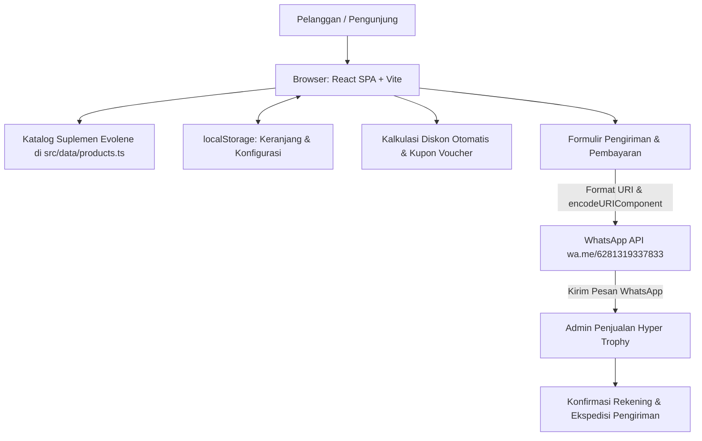

# Arsitektur Sistem — Hyper Trophy

## 1. Bentuk Sistem
Aplikasi frontend web modern berbasis **React SPA (Single Page Application)** dengan TypeScript dan Vite, ditata menggunakan **Tailwind CSS**. Aplikasi beroperasi di sisi klien (client-side) tanpa ketergantungan database server yang berat untuk proses pemesanan, melainkan mengalirkan data transaksi langsung ke sistem WhatsApp Business pengelola toko.



---

## 2. Struktur Modul & Komponen

```text
src/
├── main.tsx                         # Inisialisasi DOM React
├── App.tsx                          # Root component: state keranjang, filter, & modal
├── index.css                        # Import Tailwind CSS & styling global
├── types.ts                         # Interface model data TypeScript
│
├── data/
│   └── products.ts                  # Sumber data produk Evolene, sertifikasi, harga & voucher
│
├── utils/
│   └── formatters.ts                # Generator URL wa.me, format mata uang Rupiah
│
└── components/
    ├── Header.tsx                   # Top Bar: navigasi, status promo, tombol keranjang
    ├── Hero.tsx                     # Banner utama & bukti keaslian Labdoor/BPOM
    ├── PromoBanner.tsx              # Banner voucher diskon interaktif
    ├── ProductCard.tsx              # Kartu produk suplemen + aksi Beli via WA
    ├── ProductDetailModal.tsx       # Modal informasi nutrisi lengkap & aturan pakai
    ├── CartDrawer.tsx               # Drawer keranjang & perhitungan rincian diskon
    ├── WhatsAppCheckoutModal.tsx    # Formulir checkout & pembentukan draf pesan WA
    ├── FloatingWhatsApp.tsx         # Tombol melayang konsultasi instan WhatsApp
    └── Footer.tsx                   # Footer legalitas, kontak, & tautan penting
```

---

## 3. Model Data Aplikasi (Data Schema)

```typescript
// Model Produk Suplemen
interface Product {
  id: string;
  name: string;
  subtitle: string;
  category: string;
  originalPrice: number;   // Harga normal sebelum diskon
  price: number;           // Harga promo setelah diskon otomatis
  discountPercent: number; // Persentase diskon
  image: string;
  rating: number;
  reviewsCount: number;
  serving: string;
  benefits: string[];
  description: string;
  usage: string;
  bpom: string;
  inStock: boolean;
  isBestSeller?: boolean;
  isFlashSale?: boolean;
}

// Model Item Keranjang
interface CartItem {
  product: Product;
  quantity: number;
}

// Model Data Pembeli
interface CustomerInfo {
  fullName: string;
  whatsapp: string;
  address: string;
  city: string;
  postalCode?: string;
  paymentMethod: 'transfer_bca' | 'transfer_mandiri' | 'qris' | 'cod';
  notes: string;
}

// Konfigurasi Toko
interface StoreConfig {
  storeName: string;
  whatsappNumber: string; // 6281319337833
  freeShippingThreshold: number;
  standardShippingFee: number;
  tagline: string;
}
```

---

## 4. Alur Kerja Pemesanan

1. **Pemilihan Produk & Jumlah:** Pelanggan memilih suplemen dari katalog (misal: *Evowhey*, *Evomass*, atau *Prevo*).
2. **Kalkulasi Diskon Otomatis:**
   - `Total Normal = Σ (originalPrice × qty)`
   - `Total Promo = Σ (price × qty)`
   - `Total Diskon Produk = Total Normal - Total Promo`
   - `Total Penghematan = Total Diskon Produk + Diskon Voucher`
   - `Total Akhir = Total Promo - Diskon Voucher + Ongkir`
3. **Penyusunan Formulir:** Pelanggan mengisi data nama, kontak WhatsApp, alamat, dan metode pembayaran di modal checkout.
4. **Pembentukan Tautan WhatsApp:**
   - Draf teks disusun dengan rapi menggunakan Markdown WhatsApp (`*bold*`, `~strikethrough~`, `_italic_`).
   - Teks di-*encode* menggunakan `encodeURIComponent`.
   - URL dibentuk: `https://wa.me/6281319337833?text=<encoded_message>`.
5. **Eksekusi:** Jendela WhatsApp dibuka di tab baru saat pelanggan menekan tombol kirim.
