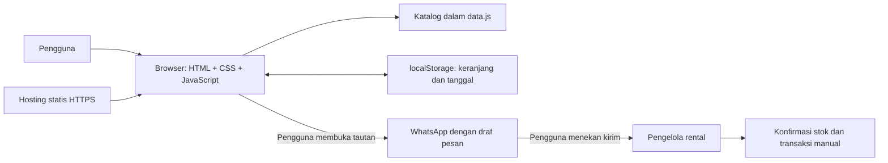
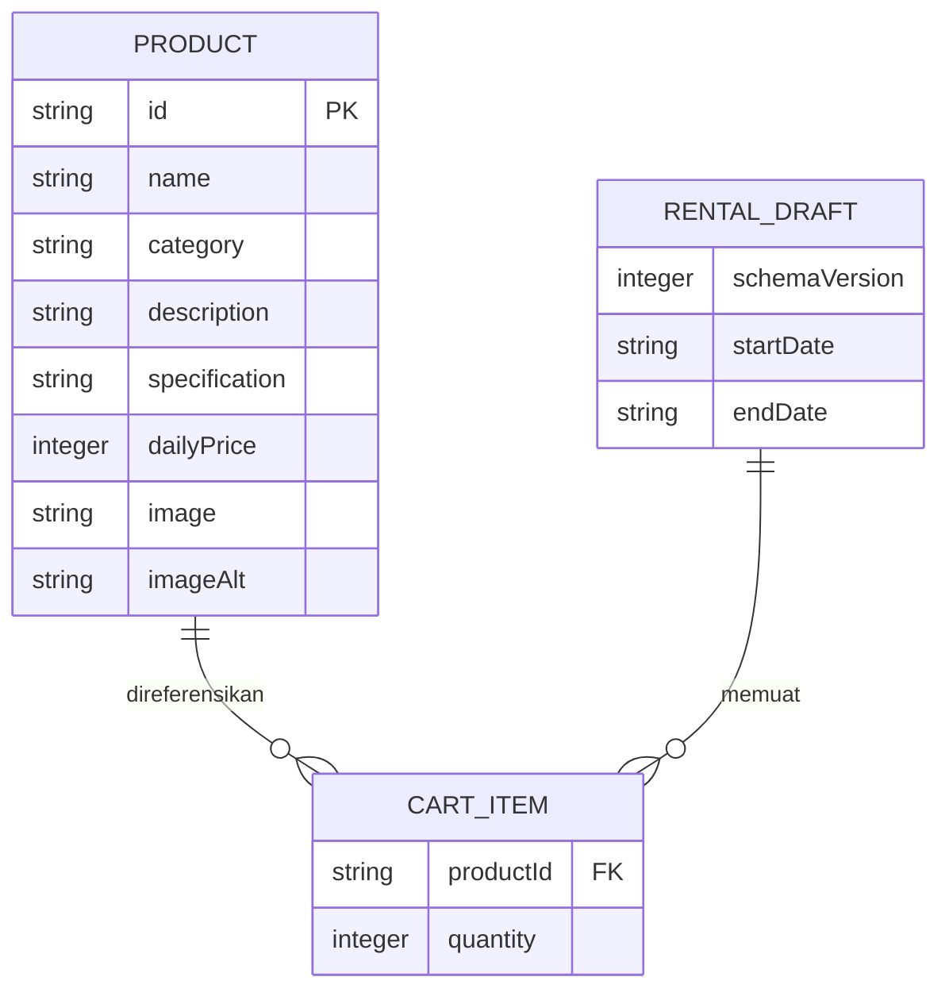

# Arsitektur Sistem — Puncak Rental

## 1. Bentuk sistem
Aplikasi frontend statis satu halaman, dibagi menjadi modul JavaScript. Ini bukan microservices dan tidak memiliki backend monolith. Server hosting hanya mengirimkan HTML, CSS, JavaScript, dan gambar. Seluruh pencarian serta perhitungan berjalan di browser.



## 2. Struktur berkas aplikasi
```text
hiking/
├── index.html
├── css/styles.css
├── js/
│   ├── config.js       # Identitas usaha dan nomor WhatsApp publik
│   ├── data.js         # Data katalog
│   ├── app.js          # Inisialisasi, render, pencarian, filter
│   ├── cart.js         # Manipulasi keranjang dan perhitungan murni
│   ├── storage.js      # Baca/tulis aman, validasi skema
│   └── checkout.js     # Validasi formulir dan pembentukan tautan
├── assets/images/
├── prd.md
├── tech_stack.md
├── arsitektur.md
├── ui.ux.md
└── instruction.md
```
Berkas aplikasi di atas telah diimplementasikan. Repository juga memuat `README.md`, `verification.md`, pengujian pada `tests/`, dan pembuat paket statis pada `scripts/package_site.py`.

## 3. Model data

Diagram menggambarkan hubungan objek frontend, bukan tabel database yang sudah tersedia. Nama dan nomor penyewa bersifat sementara pada formulir, terpisah dari data persisten. Subtotal, durasi, dan total adalah nilai turunan yang dihitung ulang.

Contoh penyimpanan dengan kunci `puncak-rental:cart:v1`:
```json
{
  "schemaVersion": 1,
  "items": [{ "productId": "tenda-2p", "quantity": 2 }],
  "startDate": "2026-11-10",
  "endDate": "2026-11-12"
}
```

## 4. Alur kerja
### Memuat halaman
1. Muat konfigurasi dan katalog lokal.
2. Baca localStorage dalam `try/catch`.
3. Validasi versi, tipe data, ID produk yang dikenal, jumlah bulat 1–99, dan bentuk tanggal. Abaikan entri rusak atau ID yang tidak ada; versi tak dikenal direset.
4. Tanggal yang sudah lewat dihapus dan pengguna diminta memilih ulang.
5. Render katalog, keranjang, dan total dengan harga katalog terkini.

### Mengubah keranjang
1. Terima ID barang dari kontrol UI dan cocokkan dengan katalog.
2. Tambah atau ubah jumlah dalam state tunggal.
3. Hitung ulang biaya jika tanggal valid; jika belum, tampilkan permintaan memilih tanggal.
4. Render dan simpan bagian state yang diperbolehkan.
5. Jika penyimpanan gagal, pertahankan state sesi dan tampilkan pemberitahuan singkat.

### Mengajukan penyewaan
1. Validasi keranjang, tanggal, nama setelah trim, dan nomor kontak.
2. Tampilkan ringkasan final beserta keterangan estimasi dan konfirmasi stok.
3. Susun teks dari katalog dan state terbaru; encode seluruh teks memakai `encodeURIComponent`.
4. Bentuk `https://wa.me/<nomor-usaha>?text=<pesan>` dari konfigurasi nomor internasional berupa digit saja.
5. Buka tautan melalui tindakan pengguna. Tidak mengirim pesan secara otomatis dan tidak menampilkan status “pesanan berhasil”.
6. Pertahankan keranjang setelah pengalihan; pengajuan yang sama mungkin dibuka ulang dan belum menjadi transaksi.

## 5. Perhitungan tanggal dan biaya
Parse `YYYY-MM-DD` menjadi komponen angka, validasi kembali komponennya, dan gunakan `Date.UTC(year, month - 1, day)` untuk menghitung selisih hari kalender. Bandingkan tanggal mulai dengan tanggal lokal hari ini yang dibentuk dari komponen tahun, bulan, dan hari lokal; hindari `toISOString()` untuk menentukan hari lokal. Total hanya dihitung bila tanggal akhir lebih besar dari tanggal mulai. Nilai uang adalah integer rupiah.

## 6. Integrasi dan batas kepercayaan
WhatsApp merupakan satu-satunya integrasi pihak ketiga MVP, melalui tautan biasa tanpa SDK/API. Data kontak dan rincian pengajuan akan masuk ke URL WhatsApp saat pengguna menekan tombol; beri penjelasan di dekat tombol. Jangan minta data sensitif seperti nomor identitas. Browser dan localStorage dapat dimodifikasi pengguna, sehingga total hanya merupakan estimasi dan harus diperiksa pengelola.

## 7. Keamanan dan penanganan kegagalan
Gunakan `textContent` untuk input pengguna dan data dinamis; hindari interpolasi input ke `innerHTML`. Jika memakai tab baru, gunakan `rel="noopener noreferrer"`. Tidak ada rahasia atau validasi stok yang dipercaya dari browser. Gambar gagal dimuat memiliki fallback lokal. Pencarian kosong, tanggal salah, storage tidak tersedia, dan konfigurasi nomor usaha tidak valid memiliki keadaan UI yang jelas. Situs masih dapat menampilkan konten dasar saat JavaScript gagal, dengan pesan `noscript` untuk fitur interaktif.

## 8. Deployment
Unggah aset runtime ke hosting statis melalui HTTPS. Tidak ada proses build, migrasi database, atau fungsi server. Dokumentasi tetap di repository dan tidak perlu masuk paket publik. Untuk rollback, unggah ulang paket runtime versi sebelumnya. Panduan operasional ada di `instruction.md`.
